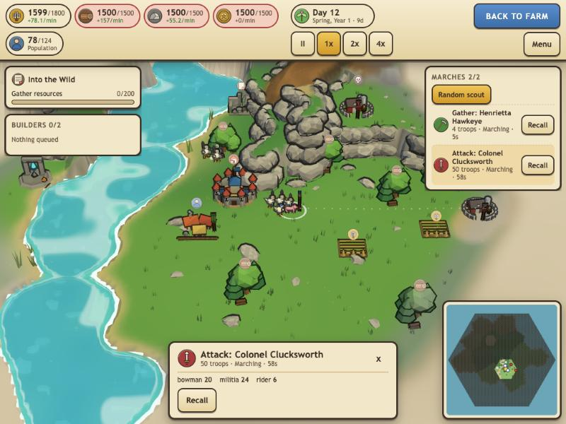
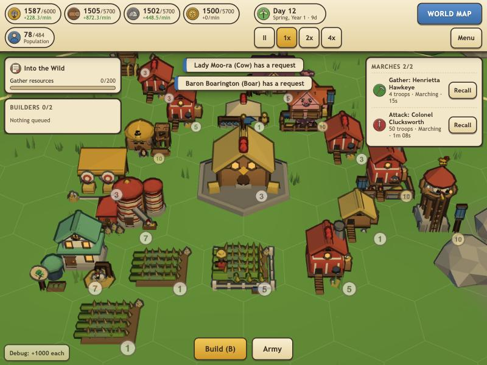
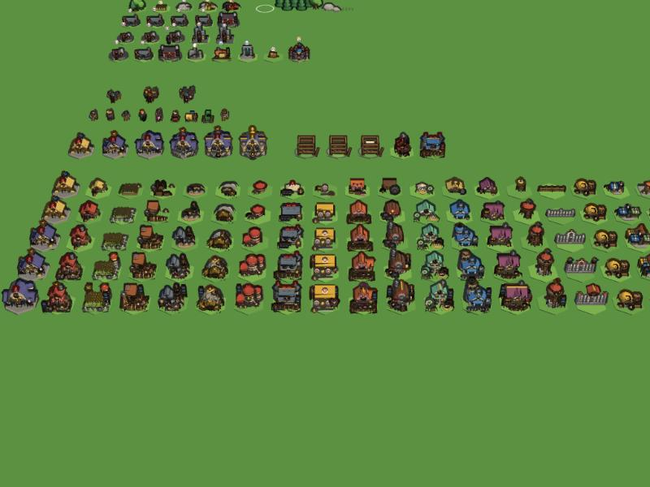
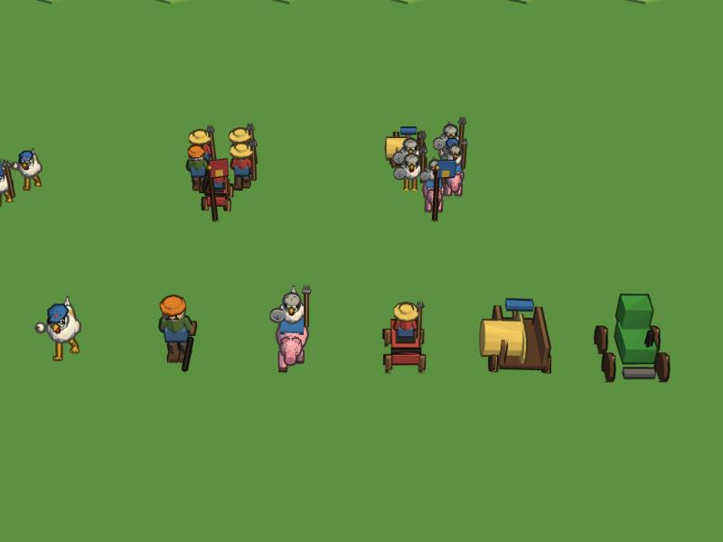
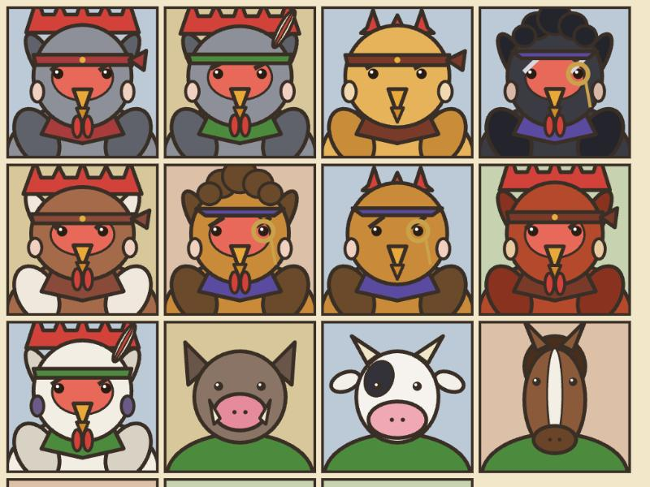
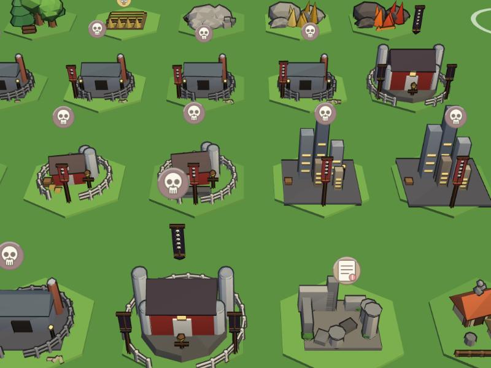

# ChickenWars

A single-player, offline 4X strategy game in the style of Rise of Kingdoms, played as a flock of chickens. Build your coop farm, send marches of pitchfork chicks, egg slingers and piglet riders to gather and fight on a living world map, recruit hero chickens, ally with animal lords (a boar, a cow, an owl...) and push back the humans' farms and cities. Cartoon, cel-shaded, isometric 3D. Almost every visual is generated in code.

Theme guide: `docs/08-theme.md`. Reference project reviewed for models and concepts: `docs/09-chickenwars-reference.md`.

No timers-for-money, no speedups, no PvP, no server. The world itself is the threat.

## Screenshots

| | |
|---|---|
|  |  |
| **World map:** marches, gather nodes, human outposts, minimap | **Coop farm:** hex-placed buildings, fields, ally requests |
|  |  |
| **Buildings:** every one grows through visible upgrade stages | **Units:** chicks, soldiers, slingers, piglet riders |
|  |  |
| **Heroes and animal lords:** portraits drawn in code | **The enemy:** human farms, feedlots and outposts |

## Technical achievements

- **Zero art assets.** Every mesh, texture, icon, portrait and sound is generated in code: procedural 3D models in `src/gen` and `src/render`, a cel-shaded outline look, and WebAudio synthesis (marimba strikes, formant chicken clucks, a seeded pentatonic music sequencer). The repo ships no image or audio files for the game; even the PWA icon is emitted at build time.
- **A pure, deterministic simulation.** `src/sim` imports no three.js, DOM or UI, and never touches `Math.random` or the clock. Time is `state.tick`, randomness is a seeded RNG, and ESLint enforces the boundary. The same seed plus the same command log gives the same state hash, checked by a 20,000-tick determinism test.
- **Plain-data state and a command layer.** `GameState` is JSON-serialisable, and the UI and renderer only dispatch validated commands. That makes save, load, migrate and hash straightforward: a fresh standard-size save is about 234 kB.
- **Procedural terrain in a Web Worker.** Hex islands with ramps, cliffs and biomes are generated from a seed in under 1 s even at radius 60, then meshed in chunks with LOD. A hashed logic layer is tested for connectivity and ramp slope across seeds.
- **Fast at endgame scale.** With 100 marches, 68 camps and 4,400 troops, a sim tick averages 0.35 ms (budget 2 ms), measured with `npm run bench`.
- **Data-driven content.** Buildings, troops, heroes, quests, events and balance numbers live in `data/*.json`, validated by zod schemas. A balance bot plays the economy to check pacing.
- **Offline and installable.** A hand-written service worker precaches the build, so the game runs fully offline as a PWA. There are no network calls at runtime.
- **Big but tested.** About 26,000 lines of TypeScript across 45 test suites, plus accessibility options (reduced motion, colour-blind markers, UI scaling).

## Start here

| If you are... | Read |
|---|---|
| A build agent | `CLAUDE.md`, then `docs/ROADMAP.md`, then the spec for the milestone you are on |
| Reviewing the design | `docs/00-overview.md`, `docs/05-decisions.md` |
| Looking for open questions | `docs/06-open-questions.md` |
| Looking for the chicken theme and name mapping | `docs/08-theme.md`, `docs/09-chickenwars-reference.md` |

## Layout

```
CLAUDE.md                 rules for any coding agent working here
HANDOFF.md                original planning-chat handoff (history, terrain notes)
docs/                     overview, architecture, approach, art, terrain, roadmap, decisions
docs/systems/             one spec per game system
data/                     data-driven content (JSON): buildings, troops, heroes, nodes, ...
src/                      game code (see src/README.md)
tests/                    vitest suites (sim determinism, balance sanity, save round-trip)
tools/                    dev scripts (balance sim, data validation)
prototypes/hex-island-poc the single-file terrain prototype to port (do not edit)
reference/images/         style reference
```

## Run it

```
npm install
npm run dev        # vite dev server (http://localhost:5173)
npm test           # vitest
npm run typecheck  # tsc --noEmit
npm run lint       # eslint
npm run validate   # validate data/*.json against schemas
npm run build      # typecheck + production build into dist/
npm run preview    # serve dist/ (http://localhost:4173); the service worker only runs here
```

### URL params
`?seed=N` fixed seed (starts a new game), `?size=small|standard`, `?difficulty=easy|normal|hard`, `?start=<start type>`, `?clan=<clan id>`, `?scene=world|base`, `?new=1` skip the autosave, `?demo=1` pre-built demo city, `?debug=1` overlay (`?debug=terrain|gallery` dev views).

### Keybinds (remappable in Settings)
Space pause, 1/2/3 speed, B build, H heroes, R research, T diplomacy, J quests, M or Tab base/world, Esc close or pause menu, backquote debug overlay.

## Production build, offline and PWA

`npm run build` writes a static site to `dist/` with relative URLs, so it can be served from any folder or sub-path. The build emits `icon.svg` (generated by code in `vite.config.ts`; no image files are committed), links `manifest.webmanifest`, and fills `sw.js` with a build id and the precache list of every built file. In production the game registers `sw.js` (`src/platform/pwa.ts`), which serves the app shell cache-first, so after the first load the game runs fully offline and can be installed from the browser. A new build gets a new cache name and replaces the old one on the next visit. Browsers allow service workers only on https or localhost. There are no network calls at runtime other than same-origin static files. Saves live in IndexedDB and settings in localStorage.

## Audio and accessibility

Sound is synthesised with WebAudio (no files) and stays silent until your first click or key press (browser policy). Mute, music and effects volumes are in Settings. Settings also has UI scale, text size, reduced motion (defaults to the OS preference) and colour-blind markers (shapes and symbols beside colours; `document.body.dataset.colourblind` is `"true"` when on, for the renderer).
